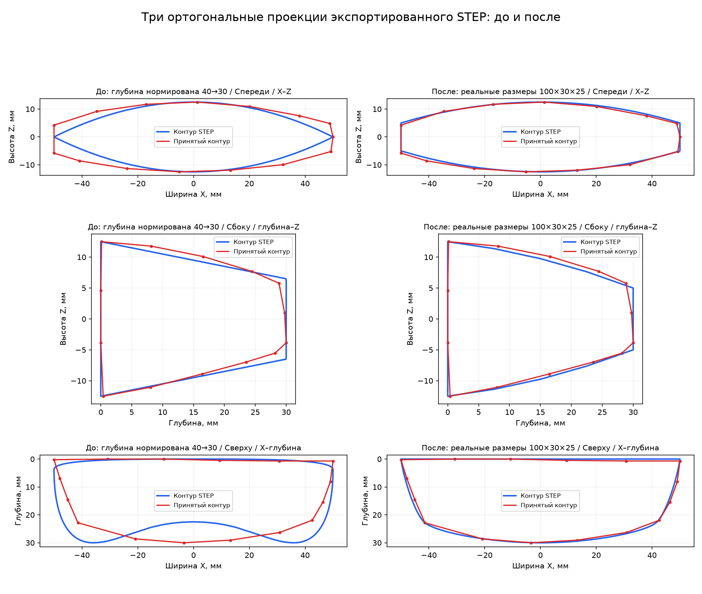
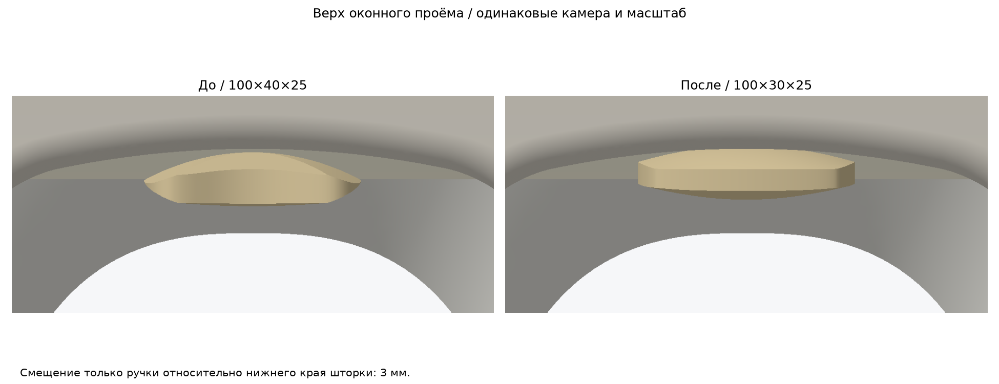

# Ручка шторки — исправление по принятым контурам

Пользователь принял красные контуры диагностического коммита51c8a43. Исправлена только ручка; новые файлы находятся в этой папке. Исходные панели, чашки, шторки и сборочные STEP не изменены (SHA-256 проверены).

Габариты экспортированного и повторно импортированного STEP: **100×30×25 мм**. Передняя кромка сверху выпуклая, задняя почти прямая; фронтальные торцы имеют конечную высоту10мм. Верхняя/нижняя кожи — единые би-квадратичные Bézier-поверхности, без внутреннего ребра от пересечения двух профилей. Сохранены симметрии по X и Z.

[Новая ручка](cad/handle.step); [открытое положение окна1](cad/handle_1_open.step); [окно2](cad/handle_2_open.step). Закрытые и половинные положения также сохранены. [ZIP](handle_step_and_review.zip).

## Повторное сравнение реального STEP

Силуэты получены ортогональным проецированием треугольников **повторно импортированного STEP**, их объединением и извлечением внешней границы. Новая модель не масштабируется. Для старой модели в сравнении глубина нормирована40→30мм, чтобы оценивать форму при одинаковом габарите. Красный — ранее принятые пользователем ручные точки; это не точная метрическая оцифровка рисунка.

| Проекция | Максимальное расстояние до, мм | После, мм | RMS после, мм |
|---|---:|---:|---:|
| Спереди | 5.208 | 1.125 | 0.413 |
| Сбоку | 1.896 | 0.988 | 0.391 |
| Сверху | 7.389 | 1.014 | 0.512 |

Метрика симметрична в обоих направлениях, равномерная выборка по длине≤0.1мм. [Спереди](previews/overlay_front_after.png), [сбоку](previews/overlay_side_after.png), [сверху](previews/overlay_top_after.png). Чистые HLR SVG и CSV-силуэты сохранены в previews. Погрешность тесселяции .025мм; ограничение сравнения — ручное чтение исходного эскиза.

## Посадка на поднятой шторке

Смещение только ручки относительно нижнего края шторки: **3мм**. Нижний край самой открытой шторки остаётся197мм. Скрытая контактная площадка20×2×1.5мм сохранена и перемещается вместе с ручкой; она не становится отдельным видимым отростком.

[Полный оконный вид](previews/window_open_after.png), [косой ракурс](previews/window_oblique_after.png), [сравнение с фото](previews/photo_upper_compare.png). Камера фотографии взята из существующей регистрации по контурам окон и не подгонялась по ручке. Фотографическое наложение показывает полный силуэт до окклюзии и является качественным сравнением, а не обмером. Реальная видимая часть после окклюзии измерена отдельно маской CAD-сцены.

Выступ к салону уменьшен с40.04 до30.04мм. Отношение видимой высоты к ширине: 0.247→0.235. Варианты положения и причины выбора сохранены в report.json; ориентир тонкой полоски на фотографии приблизителен.

## Проверки

BRep валиден, одно замкнутое тело; STEP повторно импортирован. Габариты и симметрии проверены отдельно от визуального сравнения. Отсутствие пересечений с исходными панелью, чашкой и шторкой проверено в60положениях каждого из двух окон, включая последние20ммхода сшагом0.5мм; это дискретная проверка, не доказательство непрерывного sweep. Исходные CAD-файлы проверены по SHA-256. [Полный отчёт](report.json).

Воспроизведение: python -m pip install -r requirements.txt; python build_and_compare.py. Расчёт выполнялся в GitHub Actions с CadQuery/OpenCascade.
