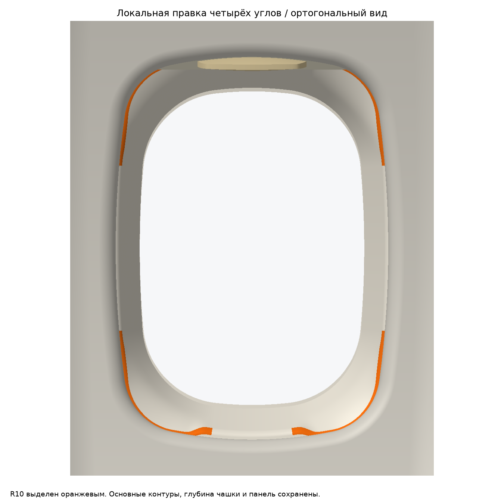
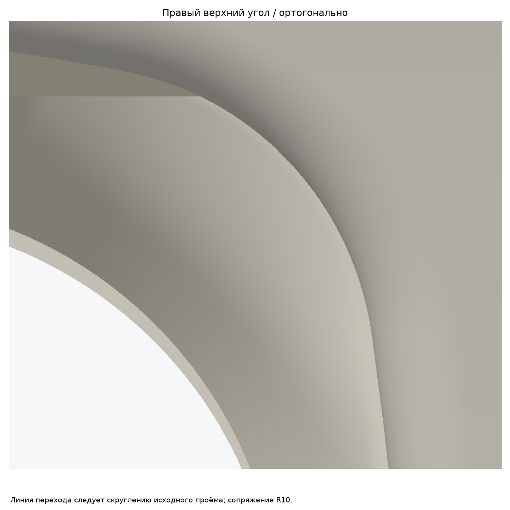
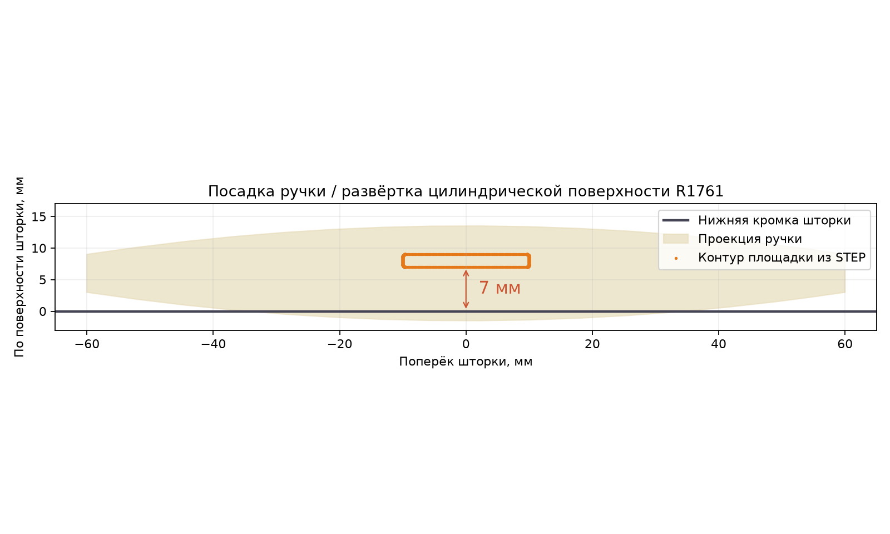

# Ту-214: локальная коррекция четырёх углов и посадки ручки

Из исходной чашки v5 заменены только объёмы в четырёх симметричных угловых областях. Новая линия перехода ориентирована по нативному контуру проёма панели; сопряжение выполнено R10 с параллельной задней поверхностью и толщиной3мм. Основные участки большого контура, внутреннее отверстие247×345 и глубина чашки сохранены. Сохранность граничных поверхностей вне локальных областей проверена в обоих направлениях; исходный остаток чашки использован без перестроения.

Форма ручки120×30×15 не изменена: канонический STEP скопирован побайтно. Уже собранная ручка с площадкой жёстко перемещена вдоль шторки. От нижнего края шторки до ближайшего края площадки —7мм по поверхности R1761. Положение и STEP-файлы шторки сохранены.

Численные проверки сохранены в[report.json](report.json). Исходная стеновая панель не изменена; её BRep-записи сохранены в сборках. Проверены открытое, среднее и закрытое положения.
