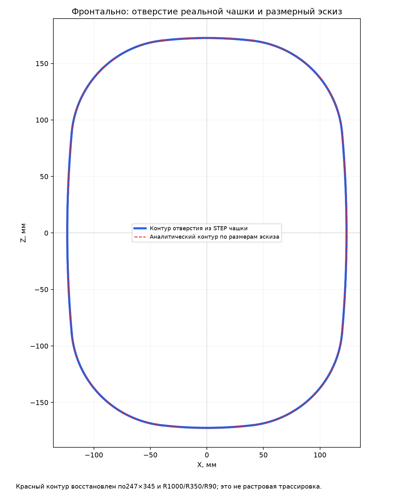
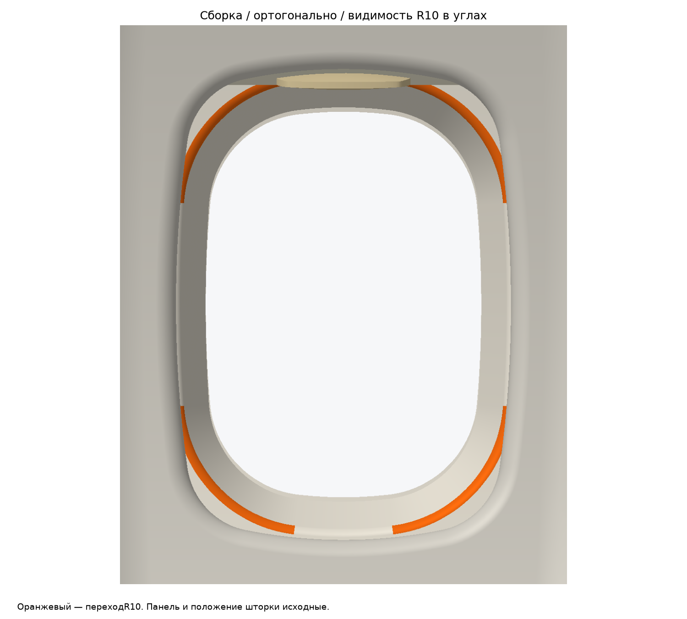
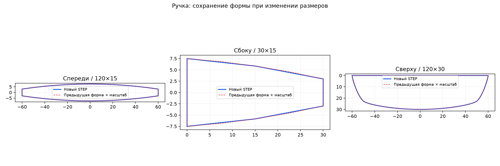
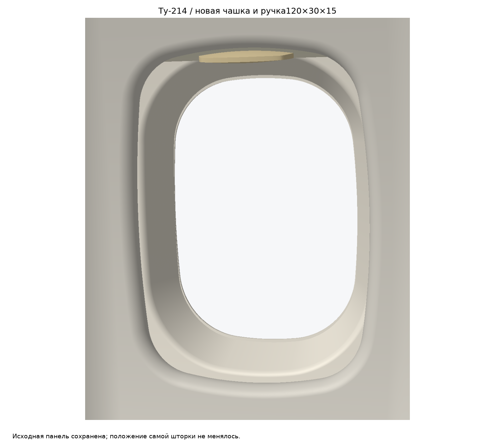

# Ту-214: аналитическая чашка и ручка120×30×15

Проём:247×345мм в ортогональной фронтальной проекции, восемь нативных окружностей R1000/R350/R90. Центры и углы вычислены по внутренней касательности; сплайновые переходы в контуре не применяются. [Проверка](report.json), [контурSTEP](cad/opening_contour.step), [чертёж](previews/opening_analytic_front.png).

Чашка строится из концентричного цилиндрического фланцаR1769.5, восьми нативных конусов с согласованными касательными и цилиндрического днаR1824.5, с последующим вырезанием точного проёма. Это аналитическая конструкция формованного углубления; произвольный Loft не применяется. Передняя поверхность плавно сопряжена R10; параллельная задняя сторона R7 сохраняет толщину3мм. Фланец приблизительно50мм по наружному нормальному направлению от устья; внешняя кромка скрывается за исходной панелью. [Сечение](previews/cup_section.png), [фланец и R10 крупно](previews/cup_section_flange_R10.png).

Ручка — непосредственное преобразование ранее принятого STEP с коэффициентами(1.2,1,0.6). Габариты120×30×15мм; изменение геометрической концепции исключено, сохранение формы проверено обратным преобразованием и тремя проекциями. Посадка+3мм относительно нижнего края шторки; сама шторка не перемещалась.

Участки скругления R10 действительно видны при ортогональном рендере исходной панели и всех деталей. Числа видимых пикселей каждого угла находятся вreport.json. [Фото и сборка](previews/photo_assembly_compare.png) используют доступный файл tu214-sidewall/references/18205_marked.png. Последняя фотография и размерный эскиз пользователя визуально прочитаны в чате; имена/растровые байты вложений не переданы, поэтому их оригиналы не включены. Геометрия проверена по точным размерам эскиза, симметрии и касательности; визуальное сравнение с фото качественное.

Исходные CAD-файлы и панель не перезаписаны; их SHA-256 совпадает. В сборочныхSTEP сохранены исходные BRep-записи панели. [Открытая сборка](cad/assembly_open.step), [Чашка1](cad/cup_1.step), [Чашка2](cad/cup_2.step), [Ручка](cad/handle.step).

Проверки перед экспортом:валидность BRep, повторный импорт, радиусы8дуг, касательность, симметрия, круговоеR10всечении, видимость всех4углов в сборке и пересечения в open/half/closed. Проверка движения между этими состояниями отдельно не выполнена. Воспроизведение: python -m pip install -r requirements.txt; python build.py.
